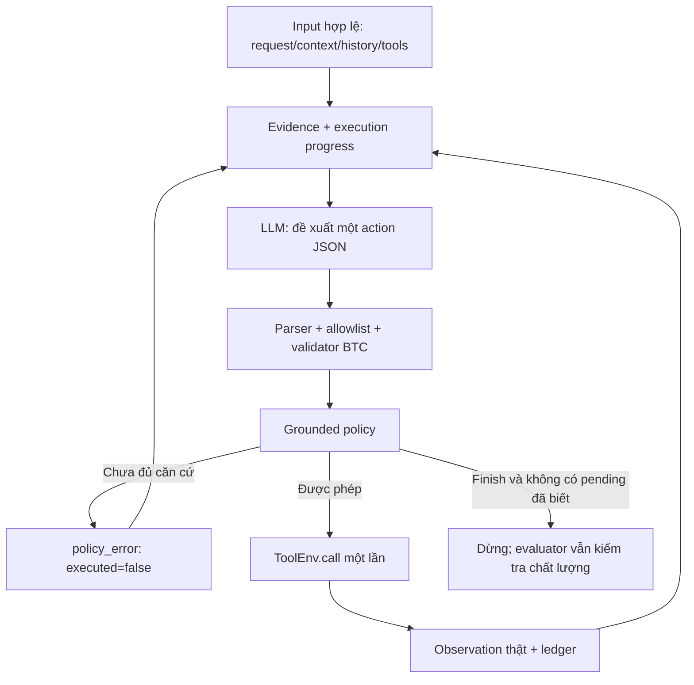

# Grounded policy v1 — hành động, tham số và hỏi thiếu

Ngày triển khai: 02/11/2026. Đây là **policy thử nghiệm**, bật bằng `--policy grounded_v1`; mặc định vẫn `--policy off`. Chỉ hỗ trợ protocol `custom_json` trong phiên bản này.

Mục tiêu là cải thiện vòng lặp hiện có bằng feedback và các kiểm tra có căn cứ, không đổi model hoặc tạo một agent/framework khác. Không tuyên bố các luật này hiểu đầy đủ ý định tiếng Việt hoặc bảo đảm hoàn thành mọi tác vụ.

## 1. Những gì đã triển khai

| Phần | Hành vi |
|---|---|
| Hướng dẫn chọn bước | Prompt bổ sung yêu cầu phân biệt tra cứu, thực thi, hỏi và kết thúc; chỉ xuất action JSON cũ |
| Nguồn ID | Kiểm tra literal user hoặc records đúng domain `x-ref` từ context có cấu trúc/history observations/current observations |
| Tra cứu trùng tên | Không chọn tùy ý giữa nhiều kết quả cùng phù hợp; có feedback hướng tới tool hỏi thiếu |
| Số điện thoại | Kiểm tra nguồn số được nêu hoặc kết quả tool; không dùng phone của một người trùng tên để né kiểm tra ID |
| Số tiền | Kiểm tra các biểu thức số tiền hỗ trợ trong user request/history; không tự coi balance là amount muốn chi |
| Ngày tương đối | Tạo anchors từ context; chặn một số trường start/time/date lệch ngày khi câu có một mốc tương đối rõ ràng |
| Schema/ask | Hỏi đúng tool đích và trường required/x-one-of; yêu cầu lookup trước khi hỏi ID nếu chưa thử lookup phù hợp |
| Kết quả và tiến độ | Ghi các bước đã gọi thật, phân biệt observed/executed/failed; `done=false` không được đánh dấu hoàn tất |
| Lặp không tiến triển | Chặn duplicate write không có căn cứ mới, cho phép một số lặp có yêu cầu rõ ràng hoặc sau write khác; hạn chế read lặp |
| Kết thúc | Nếu bước đã thử còn unresolved hoặc write thất bại chưa giải quyết, không chấp nhận finish như hoàn tất |

`src/lifemate/agent/policy.py` là module mới. Controller, protocol builder, text runner và pipeline đối chứng được mở rộng; adapter/writer vẫn là nguồn duy nhất cho executed calls/hash. Không thêm dependency, không sửa toolkit hoặc dữ liệu BTC.

## 2. Luồng cụ thể



Ví dụ: model đề xuất gọi một ID chưa có nguồn. Controller chưa dispatch; trả `ungrounded_id` cùng các lookup tools. Model tra cứu, thấy hai người cùng tên, rồi đề xuất chọn một người tùy ý: bị chặn `ambiguous_reference`. Model có thể gọi `sys.ask_missing_info` đúng schema, rồi dừng. Submission chỉ chứa lookup và ask **đã chạy thật**, không chứa các đề xuất bị chặn.

Controller không tự thay một action bằng tool khác, không tự điền ID/amount và không tự sinh call hỏi thiếu. LLM phải tạo action tiếp theo; feedback giúp nó chọn đúng nhánh.

## 3. Evidence và ranh giới dữ liệu

Evidence được phân theo domain như `contacts.contacts`, `banking.accounts`. Có ID từ banking không làm ID đó hợp lệ cho contacts. Text tự khẳng định của assistant hoặc arguments của một call chưa chạy không được coi là facts.

Chỉ thu records có ID trong collection phù hợp từ observations `ok=true` và không có `done=false`. Một số creation endpoints trả `item` được chấp nhận khi app chỉ có một domain tham chiếu có thể suy ra. Domain context phải có cấu trúc theo app; không tìm một scalar bất kỳ trong toàn bộ context rồi gọi đó là ID đúng.

User/history có thể nêu ID trực tiếp; matching literal có word boundaries. Evidence chỉ chứng minh **nguồn**, chưa chứng minh ID còn tồn tại hoặc đúng ý định user. Một ID cũ có thể đã bị xóa; việc kiểm tra nghiệp vụ vẫn qua tools.

History observations được dùng làm ngữ cảnh/evidence; **không replay history actions**. Không đọc state file hoặc mở ToolEnv thứ hai để kiểm tra nguồn. Gold không nằm trong payload hoặc summary của agent.

## 4. Giải quyết tham chiếu và hỏi thiếu

Với lookup có query và nhiều records, policy tìm lựa chọn duy nhất dựa tên/phone được nêu trong current request hoặc exact name/relation/phone tương ứng query. Nếu chưa có một lựa chọn duy nhất, write dùng tham chiếu đó bị chặn. Nếu đã có lựa chọn duy nhất, chọn ID khác cũng bị chặn.

Các luật này dùng normalization tìm kiếm, **không phải fuzzy scorer BTC**. Không coi mọi danh sách có nhiều records là mơ hồ: một inventory không có query có thể chứa nhiều thiết bị hợp lệ cho một yêu cầu nhiều mục.

Tool hỏi thiếu được kiểm tra:

- `tool_name` thuộc tools đang được phép và không tự trỏ vào `sys.ask_missing_info`.
- `params` không trùng/rỗng và thuộc required hoặc các thành viên x-one-of của tool đích.
- Nếu trường ID có lookup phù hợp mà chưa có current lookup, feedback đề nghị lookup trước.
- Nếu lookup đã trả một lựa chọn duy nhất, không hỏi lại ID đó.
- Query không có kết quả hoặc nhiều lựa chọn chưa phân biệt được cho phép hỏi thiếu.

Không tự dịch `x-one-of` thành JSON Schema `oneOf`; semantics schema vẫn do validator BTC quyết định. Một số gold ask có thể dùng trường ngoài phạm vi luật v1; mức tương thích phải đo, không coi policy là quy định BTC.

## 5. Số tiền và thời gian

V1 hỗ trợ các cách ghi phổ biến: `500 nghìn`, `500k`, `1,5 triệu`, `1.500.000 đồng`, `năm trăm nghìn`, `một triệu rưỡi`, `nửa triệu`. Khi request không có candidate, có thể dùng biểu thức từ user history gần nhất có candidate. Không lấy account balance làm số tiền muốn chuyển.

Đây là parser heuristic có giới hạn, không là bộ hiểu ngôn ngữ tài chính hoàn chỉnh. Slang, cú pháp trộn số/chữ, nhiều khoản tiền ở nhiều mục, phần trăm, mặc định nghiệp vụ và amount suy ra từ một bill có thể không được hỗ trợ đúng. Candidate xuất hiện không chứng minh khoản tiền được gắn đúng người nhận. Policy không tự đổi giá trị model đề xuất để ép nó khớp parser.

Anchors today/tomorrow/day_after_tomorrow dùng `context.current_time/timezone`, không đọc ngày giờ máy. V1 hard-check một mốc rõ ràng như “sáng mai” hoặc “hôm nay” trên một số date-bearing write arguments. Không ép `end` hoặc date range về cùng một ngày, không tự sửa timestamp.

Trên Windows không có tzdata: fallback fixed offset cho UTC, Asia/Ho_Chi_Minh, Asia/Bangkok ở các timestamp hiện đại của cuộc thi; không thay thế dữ liệu timezone lịch sử. Timezone khác không resolve được thì không tạo anchors/hard-check, vẫn giữ context cho model. Nhiều mốc thời gian, weekday hoặc ngày ISO được nêu rõ thì không áp luật tương đối đơn giản.

## 6. Theo dõi tiến độ và gọi lặp

Ledger của policy chỉ mô tả **những bước đã quan sát**, không tự suy ra toàn bộ danh sách mục tiêu của user. Model vẫn chịu trách nhiệm chọn tool và xử lý đủ yêu cầu.

- Read thành công: `observed`, không giả định đã hoàn thành task.
- Write không có lỗi nghiệp vụ: `executed`; đây vẫn không chứng minh đáp ứng đúng ý định.
- `ok=false` hoặc `done=false`: `failed`; không coi là thành công.
- Action bị schema/policy từ chối: chưa thực thi; pending chỉ là bước đề xuất còn cần giải quyết.
- Finish bị từ chối khi còn pending đã biết. Hết repair budget thì dừng `policy_limit`, không tự thêm ask/finish call hoặc sửa ledger.

Write trùng ngay sau một write thành công bị chặn khi không có write khác vào app hoặc yêu cầu lặp được nhận diện. Việc đọc lại dữ liệu không tự mở khóa việc làm lại một write đã thành công. Hai read giống nhau được phép; lần tiếp theo cùng trạng thái bị chặn để hạn chế loop.

Write thất bại không được lặp nếu chưa có evidence mới từ read liên quan. Evidence mới là tín hiệu để model cân nhắc lại, không phải controller tự retry. Exception với side effect chưa xác định vẫn làm session hỏng theo adapter hiện tại; không tạo môi trường mới để đoán lại.

Đây là heuristic: “2 lần/hai lần” có thể được nhận diện nhưng mọi cách diễn đạt lặp đều chưa được bao phủ. Một yêu cầu nhiều mục hoặc một ID từ history khác với query mới nhất có thể bị guard chặn nhầm. Tất cả calls thực tế đã xảy ra luôn giữ trong submission.

## 7. Sử dụng

```powershell
Set-Location D:\Projects\lifemate-workspace\lifemate-agent
$env:PYTHONPATH = "$(Join-Path (Get-Location) 'src');$(Get-Location)"

.venv/Scripts/python.exe -m lifemate.cli text-baseline `
  --data-root ../Data `
  --manifest ../Outputs/004-train-dev-split/run-20261102-01/split_manifest.json `
  --model-path ../Models/Qwen3-4B-Instruct-2507 `
  --protocol custom_json --policy grounded_v1 `
  --limit 3 `
  --output-dir ../Outputs/008-grounded-policy/my-policy-smoke
```

Mặc định partition là dev; để chạy diagnostic train dùng `--partition train --ids-file <JSON list>`. Không bỏ `--limit` nếu chỉ muốn smoke. `--policy off` giữ baseline; không bật policy này cùng native protocol.

So sánh train có đối chứng:

```powershell
.venv/Scripts/python.exe -m lifemate.cli compare-policies `
  --data-root ../Data `
  --manifest ../Outputs/004-train-dev-split/run-20261102-01/split_manifest.json `
  --model-path ../Models/Qwen3-4B-Instruct-2507 `
  --samples 16 `
  --output-dir ../Outputs/008-grounded-policy/my-paired-train16
```

Lệnh dùng chung pipeline đối chứng với native experiment, nhưng so `off` với `grounded_v1`, cả hai custom JSON. Mỗi mode có inference process riêng và prediction/gold replay evaluator độc lập, một ToolEnv/ID/worker. Model, IDs, budgets, packages, runtime source và scorer conventions phải khớp.

Hai mode dùng cùng weights Qwen3-4B-Instruct-2507, BF16, greedy seed 42, context 16.384, 384 new tokens, 30 s/sample, 12 decisions, 8 calls và 2 repairs. Policy prompt/feedback/guards thay đổi cùng nhau: đây là bundle experiment, chưa tách mức đóng góp từng phần.

Output gồm `off/`, `grounded_v1/`, các `*-scores/`, log, selection/ids và `comparison.json`. Chỉ chọn 16 IDs từ train partition, mỗi nhóm ask/out-of-scope/single/multi có 4. Đây là tập train đã dùng chẩn đoán ở bước trước, không phải held-out benchmark.

## 8. Trace, kiểm thử và audit

Thêm events `policy_check` và `progress_update`. Policy checks có verdict, issue codes và source mô tả cho các slot được kiểm tra. Feedback không phải observation giả; call_start/call_result vẫn chỉ bao quanh call thực tế. Raw trace/observations giữ ngoài Git trong Outputs.

88 tests đạt khi bật hai contract tests thực:

```powershell
$env:LIFEMATE_DATA_ROOT = 'D:\Projects\lifemate-workspace\Data'
$env:LIFEMATE_MODEL_PATH = 'D:\Projects\lifemate-workspace\Models\Qwen3-4B-Instruct-2507'
.venv/Scripts/python.exe -m unittest discover -s tests -v
```

Prototype policy qua 10 tests trước tích hợp; sau đó thêm controller integration tests, kiểm tra ask/lookup/duplicate/failed-write, off-mode và paired-policy alignment. Wheel ngoài source có module bytes khớp, CLI hoạt động, finish-only policy smoke 3 mẫu có trace audit hợp lệ; đây không phải GPU quality test.

Audit evaluator riêng trên gold prefixes của **1.236 train**, không dùng LLM/ToolEnv, không đưa gold vào agent: 149/2.836 gold actions bị guard từ chối, tại 124 samples. Issue counts có thể giao nhau: amount 77, phone 20, ambiguous reference 20, ID 15, lookup-before-ask 10, date 3, ask fields 3, repeat 2. Đây là tín hiệu coverage hạn chế, không phải điểm agent hoặc bằng chứng nên tune theo từng ID.

Audit script/lệnh tái lập nằm ở `Outputs/008-grounded-policy/run-20261102-03-verification/audit_teacher.py`:

```powershell
.venv/Scripts/python.exe ../Outputs/008-grounded-policy/run-20261102-03-verification/audit_teacher.py `
  --data-root ../Data `
  --manifest ../Outputs/004-train-dev-split/run-20261102-01/split_manifest.json `
  --output ../Outputs/008-grounded-policy/my-teacher-audit.json
```

## 9. Trạng thái thực nghiệm

Run 01 được hủy trước khi hoàn tất đối chứng để sửa parser “nửa triệu”/đơn vị đứng riêng. Các file partial không được dùng tính kết quả và không resume samples.

Run chính thức của diagnostic: `Outputs/008-grounded-policy/run-20261102-02-paired-train16/`; verification/audit/wheel ở `run-20261102-03-verification/`. Cả hai modes, trace audit và replay đã hoàn tất. Không thay runtime inference code giữa hai modes của run này.

| Chỉ số trên cùng 16 train IDs | Off | Grounded v1 |
|---|---:|---:|
| Mean local score | 0,31875 | 0,28125 |
| Hash matches | 11/16 | 9/16 |
| Matched calls trước hash gate | 11 | 14 |
| Actual calls | 47 | 40 |
| Call thất bại nghiệp vụ | 12 | 2 |
| Parse errors | 7 | 0 |
| Schema validation errors | 0 | 0 |
| Đề xuất bị policy chặn | 0 | 15 |
| Ask presence TP / FN / FP | 0 / 4 / 0 | 4 / 0 / 1 |
| Controller mean latency | 13,03 s | 13,30 s |
| Prediction hashes/ledgers tái tạo | 16/16 | 16/16 |

Policy cải thiện điểm ở 2 mẫu, thoái lui 4, không đổi 10. Dừng grounded: 5 asked_missing_info, 7 finished, 3 policy_limit, 1 deadline. Off tạo đúng 16/16 records như custom JSON của diagnostic 007 trước đó.

Hỏi thiếu được cải thiện trên 4 mẫu chẩn đoán, nhưng đây chỉ là matching theo sự hiện diện tên tool, chưa bảo đảm đúng arguments của câu hỏi; cũng có 1 ask FP. Matched calls và business failures cải thiện không đủ bù trạng thái cuối sai ở các mẫu khác. **Không bật grounded_v1 mặc định** và không kết luận tăng điểm dev.

Chi tiết codes của 15 policy blocks: ambiguous_reference 5, ungrounded_id 1, ungrounded_amount 6, no_progress_repeat 3. Đây là các đề xuất chưa dispatch, không phải lỗi schema/tool trong ledger. Legacy field `parse_validation_errors` trong comparison.json của run này là tổng `Outcome.errors`, gồm policy blocks; vì dễ gây nhầm, CLI sau đó đã đổi nhãn thành `controller_errors_total`. Không chạy lại LLM cho thay đổi nhãn báo cáo. `diagnostics.json` và aggregate tách riêng các loại lỗi theo trace thật.

Aggregate đã bỏ IDs/arguments/observations: `Docs/Results/grounded-policy-v1.json`. Đây là scorer local chưa có conformance BTC, tập train đã dùng chẩn đoán và bundle prompt+guard+progress; chưa thể quy mức đóng góp cho từng phần.

Giữ policy off mặc định cho đến khi có đủ bằng chứng chất lượng và coverage. Chưa fine-tune, chưa ASR, chưa chạy guarded full dev. Scorer local vẫn chưa được chứng nhận tương thích BTC.

## 10. Giới hạn và hướng kiểm chứng tiếp

Các guard chưa chứng minh tool được chọn đúng ý định, mọi tham số đúng ngữ nghĩa hoặc mọi mục đã hoàn tất. Một finish không có pending chỉ có nghĩa controller không biết còn bước đề xuất bị lỗi, không có nghĩa task thành công. Hành động từ model có thể sai dù dùng ID có nguồn và số tiền xuất hiện trong lời user.

Ưu tiên mở rộng coverage theo loại lỗi chung, tách prompt-only khỏi guard-only để đánh giá, rồi dùng các mẫu train khác làm kiểm tra tiến bộ. Không đổi mặc định hoặc kết luận đạt chất lượng trên 309 dev từ một diagnostic nhỏ. Nếu model vẫn không chọn được bước, cần training trajectory/LoRA, thay vì tiếp tục chồng quy tắc theo từng mẫu.

Tham khảo thiết kế vòng agent/evaluator từ [Qwen-Agent](https://github.com/QwenLM/Qwen-Agent) và [tau-bench](https://github.com/sierra-research/tau-bench); không lấy framework, code, reward hoặc dữ liệu của các repo đó để thay contract BTC.
