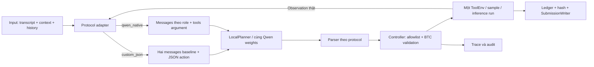

# Qwen native tool-calling

Triển khai ngày 02/11/2026. Hai chế độ chạy song song trong mã nguồn:

- `custom_json`: mặc định, giữ giao thức/prompt JSON baseline hiện tại.
- `qwen_native`: truyền tools vào tokenizer template, dùng assistant tool calls và tool responses theo template của Qwen3-4B-Instruct-2507.

Không đổi weights, BF16, greedy seed 42, context 16.384 tokens, 384 new tokens/decision, deadline 30 s/sample, max 12 decisions/8 calls/2 repairs. Hai mode **không có cùng prompt bytes**: chỉ dẫn format và cách biểu diễn hội thoại thay đổi theo protocol; policy cốt lõi được giữ.

## 1. Luồng thực thi



Module mới: `src/lifemate/agent/protocol.py`. Controller, planner và text runner tái sử dụng các module đã có; không thêm framework agent hoặc dependency.

Prototype protocol/parser đã qua 6 tests trong experiment 007 trước khi chuyển vào repo agent; kiểm thử, lệnh chạy và kết luận được hợp nhất ở đây. Không giữ source hoặc wrapper trùng trong Experiments sau tích hợp.

Nguồn thiết kế: [Transformers tool use, v4.56.2](https://huggingface.co/docs/transformers/v4.56.2/en/chat_extras), [Qwen3 function calling](https://github.com/QwenLM/Qwen3/blob/main/docs/source/framework/function_call.md). Template thực tế được kiểm tra từ tokenizer local, không tự viết một template thay thế.

## 2. Input và lịch sử

Native mode chuyển tools sang `type=function`, gồm name, description và parameters. Schema extensions của BTC được giữ nguyên; không tự đổi `x-one-of` thành `oneOf`, không dùng grammar hoặc lược bỏ schema để giảm token.

History được biểu diễn thành user/assistant/tool messages. Các call/result history **chỉ được serialize làm ngữ cảnh**, không dispatch lại. Context hiện tại và request được đưa trong user message cuối, sau history; không dùng thời gian máy thay `context.current_time`.

Mỗi call của lượt hiện tại tạo assistant tool-call message; observation thực tế tạo tool message. Nội dung user/tool/history được serialize JSON và escape dấu góc để không chèn nguyên văn chat-template delimiters. Không đưa Reference, label hoặc final_state vào messages.

History call/result lệch số lượng bị từ chối thay vì im lặng bỏ bớt. Tool calls trong history được tuần tự hóa theo thứ tự BTC cung cấp; đây không phải suy luận rằng tất cả tool có thể chạy độc lập.

## 3. Hợp đồng parser và điều khiển

Native output hợp lệ:

```text
<tool_call>
{"name": "notes.create", "arguments": {"body": "Nội dung"}}
</tool_call>
```

Parser chuyển nó về action contract nội bộ `{type: call, name, arguments}`. Tên và arguments vẫn phải qua allowlist và validator BTC trước dispatch. Ví dụ chỉ minh họa giao thức; tên trường thực tế theo schema của từng tool.

- Chỉ chấp nhận **một call hoàn chỉnh mỗi quyết định**. Nhiều calls trong một generation bị reject toàn bộ để repair; không lấy call đầu, không thực thi song song.
- Reject JSON trùng key, non-finite values, arguments không phải object, extra action keys, tags thiếu/không khớp và đầu ra JSON theo giao thức cũ.
- JSON decoder đọc đủ object nên một chuỗi argument chứa chữ `</tool_call>` không tự cắt object ở giữa.
- Text thông thường không có tool call được coi là `finish`. **Finish là dừng, không chứng nhận thành công**; scorer vẫn kiểm tra calls/hash.
- Generation chạm token limit bị reject trong native mode, kể cả có phần đầu giống một call hoàn chỉnh. Không suy ra output bị cắt là quyết định finish có chủ ý.
- Parse/validation feedback được đưa thành controller feedback với `executed=false`, không tạo một observation giả cho call chưa chạy.
- Hỏi thiếu vẫn phải thực thi `sys.ask_missing_info`; lời hỏi bằng text thuần không được thay cho tool này.

Native decoder giữ các output tags/control tokens để parser kiểm tra. EOS vẫn được backend nhận diện trước khi thêm vào output. Không bật thinking cho model 2507 và không có parser dành cho thinking models khác.

Việc này chưa thêm policy chặn loop, tự xác nhận hoàn tất hoặc xử lý `done=false` mới. Observation được giữ đầy đủ, agent vẫn cần tự chọn bước tiếp; thay các policy đó là thí nghiệm khác.

## 4. Chạy một chế độ

PowerShell từ repo:

```powershell
Set-Location D:\Projects\lifemate-workspace\lifemate-agent
$env:PYTHONPATH = "$(Join-Path (Get-Location) 'src');$(Get-Location)"

.venv/Scripts/python.exe -m lifemate.cli text-baseline `
  --data-root ../Data `
  --manifest ../Outputs/004-train-dev-split/run-20261102-01/split_manifest.json `
  --model-path ../Models/Qwen3-4B-Instruct-2507 `
  --protocol qwen_native `
  --limit 3 `
  --output-dir ../Outputs/007-qwen-native-protocol/my-native-smoke
```

Mặc định partition là dev. Bỏ `--protocol` giữ custom JSON. Bỏ `--limit` chạy toàn partition; dev hiện tại có 309 mẫu. Output phải là thư mục mới, ngoài Data.

Có thể dùng `--partition train --ids-file <file.json>` để chọn danh sách ID riêng trong 1.236 train. IDs phải duy nhất, thuộc đúng partition; `--ids-file` không dùng cùng `--limit`. Đây không phải cơ chế đưa labels vào agent.

Report/provenance ghi protocol, partition, selected-ID fingerprint, ID-file fingerprint, SYSTEM prompt hash, config và model/source metadata. Trace và ledger audit luôn bật như P0.

## 5. Chạy so sánh có đối chứng trên train

```powershell
.venv/Scripts/python.exe -m lifemate.cli compare-protocols `
  --data-root ../Data `
  --manifest ../Outputs/004-train-dev-split/run-20261102-01/split_manifest.json `
  --model-path ../Models/Qwen3-4B-Instruct-2507 `
  --samples 16 `
  --output-dir ../Outputs/007-qwen-native-protocol/my-paired-train16
```

Selector seed 42 chỉ lấy IDs trong train partition, phân nhóm hỏi thiếu, ngoài phạm vi, một call và nhiều calls. Gold chỉ dùng để phân tầng **tập chẩn đoán train**, không đi vào planner. Không chọn mẫu theo baseline sai/đúng và không lấy public/private test.

Lệnh chạy hai inference processes riêng, sau mỗi mode chạy evaluator với prediction/gold replay độc lập. Giữ đúng một ToolEnv/ID trong từng inference/evaluator worker. Không reset hoặc reuse môi trường giữa hai modes.

```text
my-paired-train16/
  selection.json, ids.json
  custom_json.log, qwen_native.log
  custom_json/          # submission, report, provenance, trace, audit
  qwen_native/
  custom_json-scores/   # independent replay + local fuzzy scores
  qwen_native-scores/
  comparison.json      # paired deltas, counts, stop reasons, latency
```

Comparison từ chối IDs lệch, model/manifest/packages khác, budgets khác, runtime source thay đổi hoặc scorer conventions khác. Model được đối chiếu bằng path/revision/metadata hiện có, không hash lại toàn bộ weight shards trong mỗi run.

Theo dõi tiến độ bằng các `sample_results.jsonl` hoặc log tương ứng; ví dụ:

```powershell
Get-Content ../Outputs/007-qwen-native-protocol/my-paired-train16/custom_json.log -Tail 3
Get-Content ../Outputs/007-qwen-native-protocol/my-paired-train16/qwen_native.log -Tail 3
```

Tập 16 mẫu cân bằng là kiểm tra tích hợp/chẩn đoán, **không đại diện phân phối dev**. Chạy custom trước native; thời gian ở đây không phải speed benchmark đã kiểm soát nhiệt độ/cache. Không lấy một vài mẫu cải thiện làm bằng chứng native tốt hơn trên toàn dev.

## 6. Kiểm thử

```powershell
$env:LIFEMATE_DATA_ROOT = 'D:\Projects\lifemate-workspace\Data'
$env:LIFEMATE_MODEL_PATH = 'D:\Projects\lifemate-workspace\Models\Qwen3-4B-Instruct-2507'
.venv/Scripts/python.exe -m unittest discover -s tests -v
```

74 tests đạt khi bật cả runtime và local-tokenizer contract tests. Không đặt hai biến này thì các contract tests tương ứng được skipped; unit tests không cần tải model hoặc mở ToolEnv thật.

Các test mới gồm parser sai/parallel/cutoff, current-vs-history dispatch, schema extensions, delimiter escaping, repair không giả observation, train-only sampling và alignment của paired comparison. Tokenizer contract test thực sự render `tools`, `tool_calls`, `tool_response` bằng template local, CPU-only.

Initial-template audit trên 16 IDs được chọn: custom JSON 3.192–8.711 tokens; native 3.122–8.387 tokens. Cả hai còn đủ budget 384 new tokens ban đầu. Điều này chưa bảo đảm context đủ ở mọi quyết định về sau.

Audit history trên toàn train: 1.545/1.545 inputs serialize thành native messages không lỗi, gồm 1.018 mẫu có history và 3.661 cặp history call/result. Audit này không mở ToolEnv hoặc thực hiện inference, nên không phải điểm chất lượng agent.

Wheel đã được kiểm tra ngoài source: module bytes khớp, CLI `compare-protocols` hoạt động và finish-only native smoke 3 mẫu có trace audit hợp lệ. Đây là plumbing smoke, không phải GPU inference hoặc kết quả chất lượng. Bằng chứng tests/build/history audit ở `Outputs/007-qwen-native-protocol/run-20261102-03-verification/`.

## 7. Bằng chứng thực thi và trạng thái

Initial-template audit: `Outputs/007-qwen-native-protocol/run-20261102-01-template-audit/audit.json`.

Paired run: `Outputs/007-qwen-native-protocol/run-20261102-02-paired-train16/`. Hai inference workers, trace audits và các replay evaluators đã hoàn tất. Không sửa code runtime giữa hai modes.

| Chỉ số, cùng 16 train IDs | Custom JSON | Qwen native |
|---|---:|---:|
| Mean local score | 0,31875 | 0,21875 |
| Hash matches | 11/16 | 7/16 |
| Matched calls trước hash gate | 11 | 9 |
| Predicted calls | 47 | 33 |
| Parse/validation errors | 7 | 1 |
| Business failure calls | 12 | 3 |
| Controller time trung bình | 15,05 s | 11,50 s |
| Deadline stops | 0 | 1 |
| Hash/ledger prediction replay | 16/16 | 16/16 |

Native cải thiện local score ở 1 mẫu, thoái lui 3 mẫu, không đổi ở 12 mẫu. Trong 4 mẫu cần hỏi thiếu, **cả hai chế độ đều không gọi đúng sự hiện diện tool hỏi thiếu** (TP=0, FN=4; không có ask FP trong tập này). Native ít lỗi định dạng hơn nhưng điều đó không đủ để cải thiện hành động.

Theo nhóm, custom/native mean local score: hỏi thiếu 0,10/0,00; ngoài phạm vi 0,50/0,50; một call 0,50/0,25; nhiều calls 0,175/0,125. Nhóm hỏi thiếu có thể chứa cả các gold calls khác nên có điểm một phần dù không gọi tool hỏi.

**Kết luận:** tích hợp native đã hoạt động, nhưng giả thuyết cải thiện chất lượng chưa được hỗ trợ bởi tập chẩn đoán này. Giữ `custom_json` mặc định. Chưa chạy native trên 309 dev: trước hết cần xem các trace bị thoái lui và cải thiện policy/grounding bằng thí nghiệm tách biệt, thay vì đổi mode chỉ vì ít lỗi format hơn. Không chỉnh prompt theo từng ID hoặc biến 16 mẫu này thành held-out benchmark.

Aggregate đã bỏ IDs/arguments/raw outputs: `Docs/Results/native-protocol-v1.json`. `comparison.json` và `diagnostics.json` đầy đủ giữ ngoài Git. Thời gian quan sát không chứng nhận tốc độ A30 hoặc latency toàn pipeline audio; scorer vẫn là local chưa có conformance BTC.

Chưa thay mode mặc định và chưa khẳng định cải thiện trên 309 dev. Muốn đánh giá toàn dev, dùng `text-baseline --protocol qwen_native` không `--limit`, rồi `evaluate-run` với manifest dev như P0. Scorer local vẫn chưa chứng nhận tương thích BTC.
