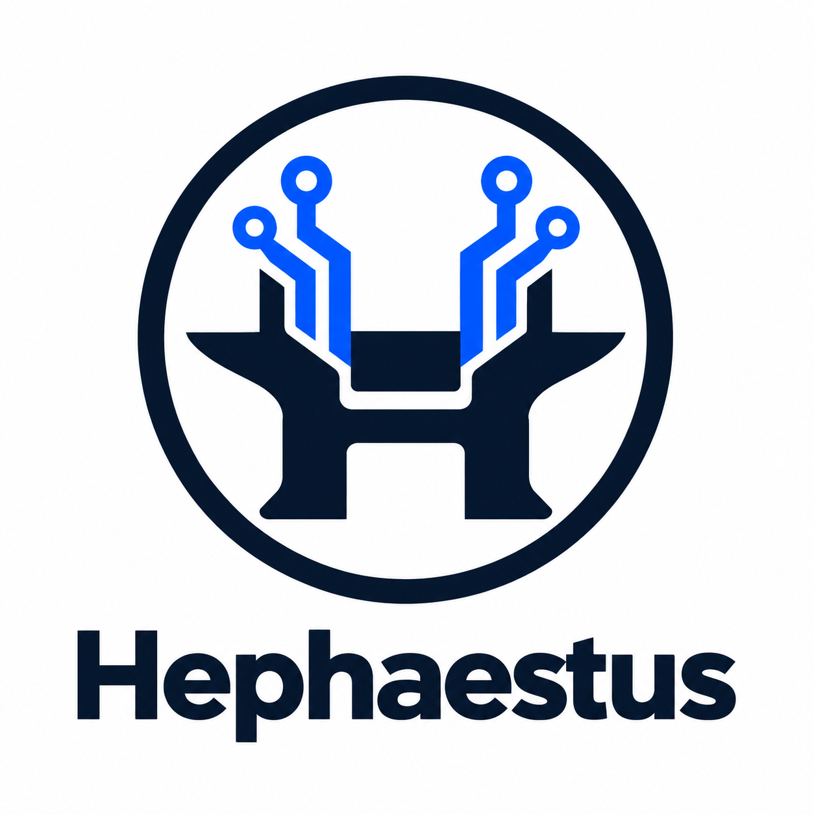

<p align="center">
  
</p>

<h1 align="center">LifeMate Agent</h1>

<p align="center">
  <strong>A Vietnamese voice-to-action agent for Zalo AI Challenge 2026:<br>
  understanding conversational context and completing tasks through the provided tools.</strong>
</p>

<p align="center">
  
  
  
</p>

## About

**LifeMate Agent** is team **Hephaestus**'s entry for the **LifeMate** challenge at **Zalo AI Challenge 2026**. The project aims to turn spoken Vietnamese requests into tool actions grounded in user context, conversation history, and tool results.

This repository hosts the team's competition solution, including implementation, configuration, evaluation, and submission materials as they become available.

## Competition

| Item | Details |
|---|---|
| Competition | Zalo AI Challenge 2026 |
| Challenge | LifeMate |
| Team | Hephaestus |
| Language | Vietnamese |
| Task | Voice-driven task completion through tool calls |

## Objectives

- **Speech recognition:** transcribe the current request and relevant user turns in conversation history.
- **Contextual reasoning:** resolve entities, references, and time expressions using the provided context.
- **Tool execution:** select available tools, validate arguments, and carry out tasks across multiple steps.
- **Clarification:** request missing information when needed and recognize requests beyond the available tools.
- **Reproducibility:** evaluate task completion consistently and prepare for offline inference under competition requirements.

## Project Status

A read-only Data Loader is available with separate agent inputs and train references, per-sample tool schemas, contract tests, and a metadata-check script. See [Data Loader usage](Docs/DATA_LOADER.md). It has been checked against 1,545 train and 634 public-test records from kit v3.2.0.

A ToolEnv Adapter is also available: [usage and verification](Docs/TOOLENV_ADAPTER.md). It has replayed 1,545 train samples (3,541 calls) with matching call ledgers and tool results. This is an integration check, not an agent quality score or a final-state comparison.

A train-only replay evaluator and strict JSONL Submission Writer are available: [usage and evidence](Docs/REPLAY_SUBMISSION.md). Gold replay matches the complete final state on all 1,545 train samples; this does not measure agent performance.

Audio audit and a fixed grouped train/dev split are available: [data preparation](Docs/DATA_PREPARATION.md). The current split contains 1,236 training and 309 development samples; detected related groups stay on the same side.

A text-agent controller, offline Transformers backend and frozen-dev evaluation runner are implemented: [text baseline](Docs/TEXT_BASELINE.md). The real-model run on all 309 dev samples is complete: 109 canonical hash matches, 82 raw-state matches, and 30 exact full-call matches. These are diagnostic metrics, not the official competition score. See [analysis](Docs/BASELINE_ANALYSIS.md) and the [aggregate baseline record](Docs/Results/text-baseline-v0.1.json).

Independent prediction replay, a schema-aware **local fuzzy scorer** and per-decision traces are available: [Evaluation & Trace v2](Docs/EVALUATION_TRACE.md). All 309 baseline prediction hashes/ledgers reproduce; the mean local score is 0.1552 under documented conventions. This scorer is not certified against the organisers' scorer. A 3-sample real-GPU trace run reproduces the original records.

ASR, organiser-scorer conformance and a complete competition deployment are not yet implemented.

Custom-JSON SFT trajectory preparation and completion-only label audits are available: [trajectory dataset](Docs/TRAJECTORY_DATASET.md). The frozen outer train is split into 1,112 fit / 124 inner-validation samples, producing 3,517 / 392 next-action examples. All 3,909 rows pass tokenizer/mask audit; the 309 outer-dev IDs remain excluded. Dataset preparation itself does not train the model.

A single-GPU QLoRA trainer and optional adapter inference are available: [training guide](Docs/QLORA_TRAINING.md). A real 4-step smoke fits the longest 10,099-token sequence in about 12.01 GiB peak reserved VRAM; saved adapter tensors reload exactly. All 110 tests pass. The 3-sample adapter pipeline smoke replays correctly but has a mean local score of zero. A subsequent 100-step pilot and paired evaluation on all 124 inner-validation samples are complete: mean local score improved from 0.18737 to 0.32133, while clarification recall remained 0/17. Both variants passed trace and independent replay checks. See [paired aggregate](Docs/Results/adapter-evaluation-v1.json). Full-epoch training and adapter evaluation on outer dev remain pending.

An optional Qwen native tool-calling mode and a paired training diagnostic runner are implemented: [native tool-calling](Docs/NATIVE_TOOL_CALLING.md). The default remains `custom_json`; use `--protocol qwen_native` to opt in. History is represented as messages, never re-executed.

On a paired 16-sample training diagnostic, native reduced format/validation errors (7 to 1) but lowered the mean local score (0.31875 to 0.21875). Both modes passed trace and independent replay checks. Native has not been promoted or evaluated on the full dev set.

An opt-in `grounded_v1` controller policy is available for custom JSON: [evidence, clarification and progress policy](Docs/GROUNDED_POLICY.md). It adds bounded reference/money/date checks, clarification feedback, failed-action tracking and repeat guards. Default remains `--policy off`; the heuristic policy has known coverage gaps and is not a proof of semantic correctness.

On the same 16 training diagnostic samples, policy improved ask-tool presence from 0/4 to 4/4, with one false positive, and reduced business-failure calls from 12 to 2. Mean local score decreased from 0.31875 to 0.28125; the policy has not been promoted. Train gold-prefix coverage also exposes valid trajectories that the heuristic guard rejects.

## Data and Submission

- Competition datasets and model weights are not included in this repository.
- The agent accesses application data through the provided tools, with gold labels excluded from its input.
- Predictions must follow the organizers' submission format, using executed tool calls and the final state hash returned by the environment.
- Data access, model usage, and submission packaging must follow the competition rules and applicable licenses.

This is a participant team's repository, not an official repository of the competition organizers.

## Source layout

Runtime code is organised under `src/lifemate/` (contracts, input, context, agent, tools, output). Offline data preparation is in `training/`; dev/replay diagnostics are in `evaluation/`. See [architecture and migration](Docs/REFACTOR_ARCHITECTURE.md).

From this repository in PowerShell:

```powershell
$env:PYTHONPATH = "$(Join-Path (Get-Location) 'src');$(Get-Location)"
.venv/Scripts/python.exe -m lifemate.cli --help
.venv/Scripts/python.exe -m lifemate.cli text-baseline --help
.venv/Scripts/python.exe -m lifemate.cli evaluate-run --help
.venv/Scripts/python.exe -m lifemate.cli replay-predictions --help
.venv/Scripts/python.exe -m lifemate.cli compare-protocols --help
.venv/Scripts/python.exe -m lifemate.cli compare-policies --help
.venv/Scripts/python.exe -m lifemate.cli prepare-trajectories --help
.venv/Scripts/python.exe -m lifemate.cli audit-trajectories --help
.venv-training/Scripts/python.exe -m lifemate.cli train-sft --help
.venv/Scripts/python.exe -m unittest discover -s tests -v
```

The old `scripts/*.py` commands remain available. Legacy `lifemate_*` packages have been removed; use canonical imports. Archived experiments require their recorded implementation version (see the migration guide). No baseline prompt, inference parameters or model weights were changed in the structural refactor.
